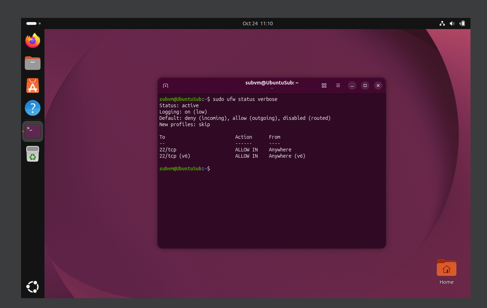
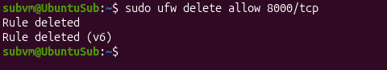
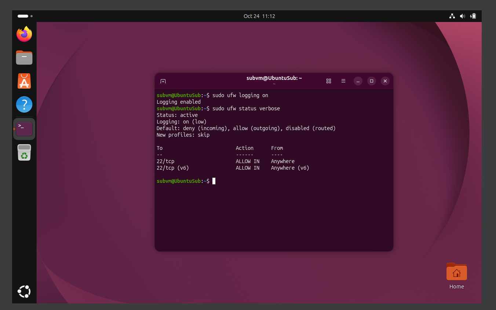
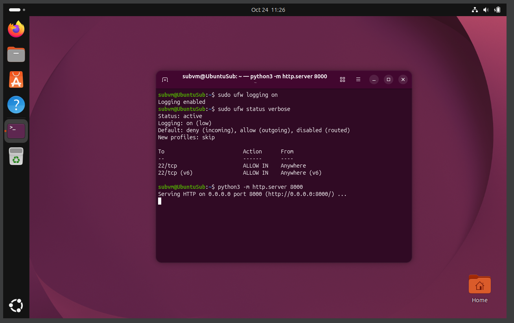
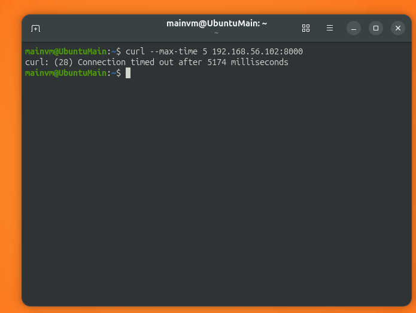
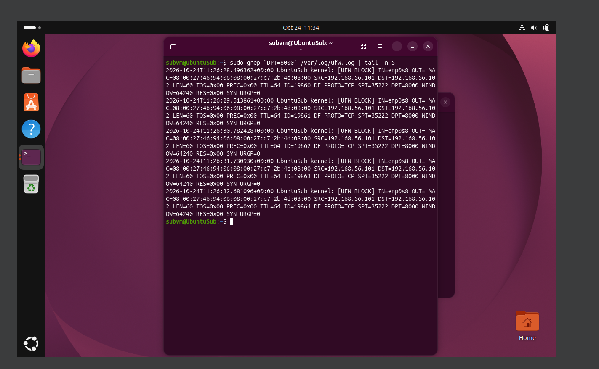

# ufw-logging-lab
Some work with ufw logs.

## Goal
Checking the log for entries about the blocked connection.

## Environment
- Host: Windows 10, VirtualBox 7.2.22
- VM1: Ubuntu 26.04, name: mainvm, IP 192.168.56.101
- VM2: Ubuntu 26.04, name: subvm, IP 192.168.56.102
- Network: Host-Only

## Setup
Check up ufw current status


```
sudo ufw status verbose
```
---
Then deleting allowing rule from previous lab work


```
sudo ufw delete allow 8000/tcp
```
---
And enabling ufw logging and checking up for status again


```
sudo ufw logging on
sudo ufw status verbose
```
## Log entries
Firstly starting up test server on subvm


```
python3 -m http.server 8000
```
---
Trying to curl test server on port 8000 from mainvm and getting timeout 


```
curl --max-time 5 192.168.56.102:8000
```
---

Looking up for log entries about this curl attempt


```
sudo grep "DPT=8000" /var/log/ufw.log | tail -n 5
```
## Results 
The firewall log on subvm shows several [UFW BLOCK] entries from 192.168.56.101 (mainvm) to port 8000/TCP. Each packet carries only the SYN flag, and all of them use the same source port (35222). This means curl was retrying the same connection attempt: it never received a SYN-ACK because ufw dropped the packets. This matches the timeout seen on mainvm.

## Problems and conclusions 
- Problems:
  - Command `sudo tail -n 20 /var/log/ufw.log` showed up too mгср extra info;
    - switching to `sudo grep "DPT=8000" /var/log/ufw.log | tail -n 5` for a more focused view.

- Conclusions:
  - Check that logging is enabled before testing.
  - Packets blocked by ufw are dropped silently, so the client only sees a timeout.
  - One blocked connection attempt appears as several log lines (SYN retransmissions from the same source port).
